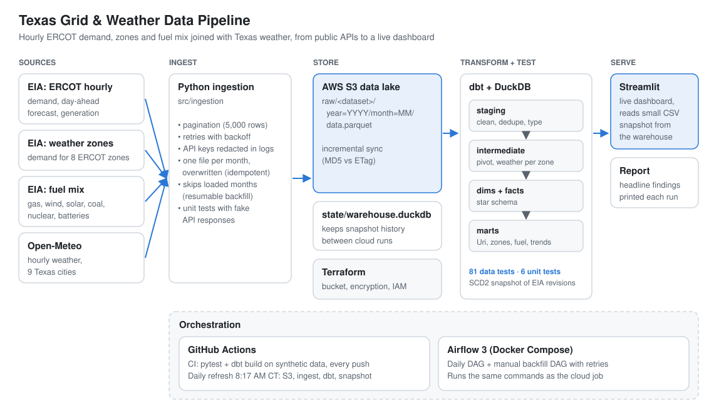
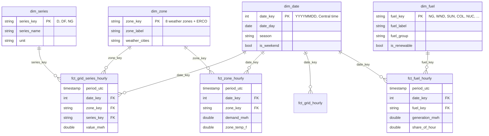

# Texas Grid & Weather Data Pipeline

[](https://github.com/ramswargam1234/texas-grid-pipeline/actions/workflows/ci.yml)
[](https://github.com/ramswargam1234/texas-grid-pipeline/actions/workflows/daily-refresh.yml)

**Live dashboard:** https://texas-grid-ram.streamlit.app

An end-to-end data pipeline that joins **hourly Texas power grid (ERCOT) demand and generation by fuel** with **hourly weather for 9 Texas cities** to answer:

- How much does temperature drive Texas electricity demand?
- When is the grid under the most stress, and how good is the day-ahead forecast?
- What happened to demand during extreme weather events (e.g., heat waves, the Feb 2021 freeze)?
- Which of ERCOT's 8 weather zones are most sensitive to heat, and is that changing year by year?
- Where does Texas get its power, and which sources carry the grid when demand peaks?

## Architecture



## Roadmap

- [x] **Phase 1: Ingestion.** EIA + Open-Meteo loaders, pagination, monthly idempotent writes, unit tests
- [x] **Phase 2: Storage.** Incremental sync of the Parquet lake to S3 (least-privilege IAM user); dbt can build straight from S3
- [x] **Phase 3: Transform.** dbt + DuckDB: staging, hourly fact table, weather-demand marts, data tests
- [x] **Phase 4: Orchestrate.** Airflow 3 DAGs (daily incremental + manual backfill) in Docker Compose, with retries and an isolated pipeline virtualenv
- [x] **Phase 5: Serve.** Streamlit dashboard (demand vs. temperature, peak hours, Winter Storm Uri, forecast error), refreshed by Airflow

## Design decisions

The reasoning behind the main choices (warehouse, storage layout, orchestration, testing, security and the
Uri method), including trade-offs and known weaknesses, is in [`docs/adr`](docs/adr/README.md).

## Try it in one command

No API keys, no AWS, no network beyond installing packages. Needs Python 3.11+ and `make` (macOS / Linux).

```bash
git clone https://github.com/ramswargam1234/texas-grid-pipeline.git
cd texas-grid-pipeline
make demo             # ~2 min the first time: installs, builds synthetic data, runs dbt with every test
make demo-dashboard   # same, then opens the dashboard on the demo data
```

`make demo` writes everything to `data/demo/`: a synthetic lake (Dec 2020 to Aug 2021, with a Winter Storm Uri-like
freeze and load shed), the DuckDB warehouse, the headline report and a dashboard snapshot. It never touches real data or the
committed dashboard snapshot. Without `make` (e.g. Windows): `pip install -r requirements.txt -r dashboard/requirements.txt`,
then `python -m src.demo --dashboard`. Run `make help` for the other shortcuts (`test`, `build`, `backfill`, `refresh`, `sync`).

## Quickstart (real data)

```bash
python3 -m venv .venv && source .venv/bin/activate
pip install -r requirements.txt
cp .env.example .env            # add your free EIA key
python -m pytest -q             # run tests

# Backfill (safe to re-run: retries on server errors, skips months already loaded)
python -m src.ingestion.eia_demand --start 2021-01-01
python -m src.ingestion.eia_zones  --start 2021-01-01
python -m src.ingestion.eia_fuel   --start 2021-01-01
python -m src.ingestion.weather    --start 2021-01-01

# Daily refresh
python -m src.ingestion.eia_demand --days 7
python -m src.ingestion.eia_zones  --days 7
python -m src.ingestion.eia_fuel   --days 7
python -m src.ingestion.weather    --days 14

# Upload new/changed files to S3
python -m src.storage.s3_sync

# Transform + test (builds data/warehouse.duckdb)
python -m src.run_dbt                  # from the local lake
python -m src.run_dbt --target cloud   # straight from S3

# Headline findings
python -m src.report
```

## Dashboard

Streamlit app in [`dashboard/app.py`](dashboard/app.py). It reads small CSV snapshots exported
from the warehouse (`dashboard/snapshot/`), so the hosted version needs no database or credentials.

```bash
python -m src.export_dashboard                 # refresh snapshot (Airflow does this daily)
pip install -r dashboard/requirements.txt
streamlit run dashboard/app.py                 # http://localhost:8501
```

## Orchestration (Airflow)

```bash
docker compose up -d --build     # first build takes a few minutes
open http://localhost:8080       # Airflow UI
docker compose down              # stop
```

| DAG | Schedule | Tasks |
|---|---|---|
| `texas_grid_daily` | 7:00 AM Central | `ingest_grid` + `ingest_zones` + `ingest_fuel` + `ingest_weather` → `upload_to_s3` → `dbt_build` → `report` + `export_dashboard` |
| `texas_grid_backfill` | manual (param: `start`) | backfill both sources → `upload_to_s3` → `dbt_build` |

- Retries with exponential backoff on every task; one run at a time (`max_active_runs=1`).
- `upload_to_s3` **skips** (doesn't fail) when `S3_BUCKET` isn't set; `dbt_build` uses `trigger_rule="none_failed"` so it still runs.
- Pipeline code runs in its own virtualenv inside the image, so dbt and Airflow dependencies never conflict.
- Tasks call the same CLI commands as the Quickstart, so local and scheduled runs behave identically.

## Automation (GitHub Actions)

| Workflow | Trigger | What it does |
|---|---|---|
| [`ci.yml`](.github/workflows/ci.yml) | every push and pull request | Unit tests, then a full `dbt build` (models + data tests) on a synthetic data lake from `src/sample_data.py`. No secrets needed. |
| [`daily-refresh.yml`](.github/workflows/daily-refresh.yml) | daily 13:17 UTC, or on demand | Pulls the lake from S3, loads the latest EIA and weather data, syncs back to S3, rebuilds dbt, and commits a fresh dashboard snapshot. Streamlit Cloud redeploys on that commit. |

The daily job uses its own IAM access key (stored as GitHub secrets `AWS_ACCESS_KEY_ID` / `AWS_SECRET_ACCESS_KEY`, plus `EIA_API_KEY`), separate from the local development key, so either can be revoked on its own.

## AWS infrastructure (Terraform)

All AWS resources are defined in [`infra/terraform`](infra/terraform). They were first created by hand in the
console, then adopted into Terraform with `import` blocks, so nothing was recreated.

| Resource | Hardening |
|---|---|
| S3 bucket (`raw/` lake) | Public access fully blocked; ACLs disabled; SSE-S3 encryption; **HTTPS-only bucket policy**; `prevent_destroy` |
| Versioning + lifecycle | Overwritten files kept **30 days** for rollback, then expired; stale multipart uploads cleaned up |
| Pipeline IAM user + policy | Least privilege: list/read/write **only under `raw/`** in this one bucket; no delete; no console login |
| Access keys | Separate keys for laptop and GitHub Actions; never in Terraform state, never in git |

```bash
cd infra/terraform
cp terraform.tfvars.example terraform.tfvars   # add your AWS account ID
terraform init
terraform plan      # review: imports + additions, 0 to destroy
terraform apply
```

Other safeguards: CI runs with a read-only `GITHUB_TOKEN`; Dependabot opens weekly PRs for Python packages and
GitHub Actions; MFA on the root account and a zero-spend budget alert.

## dbt models

```
raw parquet ─► stg_eia__ercot_hourly ─► int_grid__hourly_pivoted ─┬─► fct_grid_hourly ─┬─► agg_grid_daily
           └─► stg_weather__hourly ──► int_weather__texas_hourly ─┘                   └─► agg_demand_by_temperature
                                       int_grid__hourly_pivoted ─────► dq_grid_missing_hours
```

| Model | Grain | What it answers |
|---|---|---|
| `fct_grid_hourly` | 1 row / hour | Demand, forecast, generation + Texas weather, UTC and Central time |
| `agg_grid_daily` | 1 row / day | Daily peak demand, peak hour, weather, forecast accuracy |
| `agg_demand_by_temperature` | 1 row / 5°F band | How demand rises with heat and cold |
| `dq_grid_missing_hours` | 1 row / missing hour | Gaps in the EIA feed |
| `fct_uri_unserved_hourly` | 1 row / hour, Feb 8–21 2021 | Forecast, weather-model and actual demand during Winter Storm Uri |
| `agg_uri_summary` | 1 row | Estimated unserved energy (GWh) during the blackouts |
| `fct_zone_hourly` | 1 row / hour / zone | Demand in each of ERCOT's 8 weather zones, joined to that zone's own weather |
| `fct_grid_series_hourly` | 1 row / hour / series | Star-schema fact for the whole grid (demand, forecast, generation) |
| `rpt_eia_revisions` | 1 row / detected revision | EIA days whose published totals changed after first load (from the snapshot) |
| `fct_fuel_hourly` | 1 row / hour / fuel | Net generation by fuel type (gas, wind, solar, coal, nuclear, ...) and its share of the hour |
| `agg_fuel_monthly`, `agg_fuel_yearly` | 1 row / month / fuel, 1 row / year | Fuel mix over time; renewable and carbon-free share by year |
| `agg_fuel_by_condition` | 1 row / condition / fuel | Fuel shares in all hours vs. each year's top 5% demand hours vs. the Uri blackouts |
| `dim_date`, `dim_zone`, `dim_series`, `dim_fuel` | 1 row / date, zone, series, fuel | Conformed dimensions shared by the fact tables; `dim_date` flags US holidays and business days |
| `agg_holiday_effect` | 1 row / holiday date | Demand vs the same weekday 1 and 2 weeks around it (non-holidays), with the temperature difference |
| `agg_holiday_summary` | 1 row / holiday | Median demand change per holiday across years, leaving out weather-distorted days |
| `fct_forecast_hourly` | 1 row / hour | Actual demand vs ERCOT's day-ahead forecast vs our model (forecast stage) |
| `agg_forecast_accuracy_monthly` | 1 row / month | MAPE, bias and 3–7 PM peak MAPE for our model and ERCOT on the same hours |
| `agg_zone_profile` | 1 row / zone | Share of energy, peak, and heat sensitivity (MWh and % per °F above 75°F) |
| `agg_zone_heat_trend` | 1 row / zone / year | Heat sensitivity per year with 95% confidence intervals, fit on daily averages for days ≥ 75°F |
| `rpt_zone_heat_change` | 1 row / zone | First vs latest year; calls a change only when the two 95% intervals don't overlap |
| `rpt_zone_heat_robustness` | 1 row / zone | Reruns that verdict with zones reconciled to ERCOT's total and with 2025 left out; `is_robust` when all agree |

**Data tests (99):** primary keys unique/not null, accepted series types and cities, one row per hour and type/city, plausible demand and temperature ranges, weather coverage, and a gap-tolerance test that **warns on any missing hour and fails above 240**, a completeness check on the 72 Uri load-shed hours, zone codes that must match the zone seed, a check that the 8 weather zones add up to ERCOT's total within 3%, fuel codes that must match the fuel seed (warn, so a new EIA code never breaks the build), fuel shares that add to 100% each hour, and a check that fuel generation adds up to net generation within 3%.

## History and unit tests

- **Snapshot `snp_eia_daily_totals`** (type-2, `check` strategy) stores every version of each day's EIA totals.
  When EIA republishes a day with different numbers, `rpt_eia_revisions` shows the before and after values and
  when the change was detected. The daily cloud job keeps the DuckDB warehouse in S3 (`state/warehouse.duckdb`),
  restoring it before `dbt build` and saving it after, so snapshot history accumulates across runs.
- **dbt unit tests** (`transform/models/unit_tests.yml`) check model logic on small hand-written inputs:
  the Uri forecast-gap math and load-shed window, season and weekend flags in `dim_date`, averaging of
  multi-city weather zones, fuel shares that leave out battery charging, the heat-trend slope and confidence
  interval on a perfect line, the rule that only calls a zone's change when the intervals don't overlap, holiday and
  business-day flags in `dim_date`, a holiday baseline that skips other holidays, and forecast accuracy scored
  only on hours where both forecasts exist.

## Star schema

Fact tables share conformed dimensions through integer and code keys; every key is covered by a
`relationships` test.



Example: average demand, forecast and generation by season.

```sql
select d.season, s.series_name, avg(f.value_mwh) as avg_mwh
from fct_grid_series_hourly f
join dim_date   d using (date_key)
join dim_series s using (series_key)
group by all
order by 1, 2;
```

`fct_grid_series_hourly` keeps the narrow (hour, series) grain, so a new EIA series is a new row in the
`ercot_series` seed rather than a schema change. The wide `fct_grid_hourly` stays as a convenience table for
the dashboard.

## Finding: demand that went unserved during Winter Storm Uri

ERCOT ordered rolling blackouts from **1:20 AM Feb 15 to 12:42 AM Feb 18, 2021**. During those hours the EIA data records
the power that was *delivered*, not the power people *needed*, so a naive reading says demand fell during the coldest
days on record. `fct_uri_unserved_hourly` estimates the missing demand two independent ways:

1. **Forecast gap:** ERCOT's day-ahead demand forecast minus actual demand.
2. **Weather model:** one temperature slope plus a baseline for each hour of day, fit on cold winter hours (Dec–Feb, below 50°F)
   from every other winter, then applied to Uri's temperatures. Hours colder than any training hour are flagged as extrapolated.

**Result:** an estimated **~1,340 GWh** of demand went unserved over the 72 load-shed hours (forecast gap; the weather model gives ~1,900 GWh as an upper bound). The forecast peaked at **76,783 MW** during load shed, matching ERCOT's own ~76.8 GW estimate. The largest hourly gap, **28,885 MW**, exceeds the 20 GW ERCOT ordered shed, suggesting delivered power also fell from local outages and industrial cutbacks. For reference, ERCOT reported shedding up to 20 GW and estimated peak demand
of about 76.8 GW without load shed ([S&P Global](https://www.spglobal.com/commodity-insights/en/news-research/latest-news/electric-power/022421-ercot-lost-almost-half-of-generation-capacity-in-storm-causing-20-gw-load-shed)).

## Demand forecast (backtested)

`src/forecast` trains a gradient-boosted model (scikit-learn `HistGradientBoostingRegressor`) on hour, day of week,
business day / holiday, season, temperature, humidity, and demand at the same hour **2 and 7 days earlier** (information
available the day before). It is **backtested walk-forward**: each month is predicted by a model trained only on earlier
months, and the Uri load-shed hours are never used for training. Predictions are written to the lake like any other
dataset (`model_demand_forecast_hourly/year=/month=`), so reruns are idempotent and only new and recent months are retrained.

dbt builds in two stages because the forecast models read those predictions:

```bash
python -m src.run_dbt                    # stage 1: everything except models tagged `forecast`
python -m src.forecast                   # train + predict (add --force to rerun the whole backtest)
python -m src.run_dbt --stage forecast   # stage 2: fct_forecast_hourly, agg_forecast_accuracy_monthly + tests
```

`make build` runs all three.

Two model versions are kept (`--model v1|v2`). **v1** predicted demand in MWh from the 4-metro average temperature
and scored 4.67% MAPE vs ERCOT's 2.38% over 48,539 hours: tree models can't predict above anything they were
trained on, and Texas demand grows every year, so it kept under-forecasting. **v2** (default) predicts demand
*relative to its recent level* (the mean of the 14 days ending 2 days earlier) and sees all 9 cities' temperatures;
on synthetic demand growing 5% a year it cut the error from 4.04% to 1.72%. Tests check that lags only look back, that each month trains only on earlier months, and that
load-shed hours are excluded. **Caveat:** this version uses the *observed* temperature of the forecast day, a perfect
weather forecast, while ERCOT had to forecast the weather too. The next roadmap item scores the model with real day-ahead
weather forecasts and splits the error into weather-forecast error vs model error.

## Finding: is each zone getting more heat-sensitive?

`agg_zone_heat_trend` fits heat sensitivity for each of ERCOT's 8 weather zones and each year, on **daily** averages
for days at or above 75°F (one point per day, so the 95% confidence interval isn't inflated by neighbouring hours).
`rpt_zone_heat_change` only calls a change when the first and latest years' intervals don't overlap.

EIA's zone figures add up to 4–5% more than ERCOT's total in parts of 2025 (see [ADR 0008](docs/adr/0008-testing-strategy.md)),
so `rpt_zone_heat_robustness` reruns the same method two more ways: with each hour's zone values scaled to match ERCOT's
total, and with 2025 left out. A verdict is reported as robust only when all three agree. Because sensitivity is measured
as a **% of the zone's own average**, a uniform scaling error cancels out; the check guards against errors that are uneven
across zones or months. The trend logic lives in one macro (`macros/zone_heat.sql`), so every variant uses the same method.

## Data layout

```
data/raw/
  eia_ercot_hourly/year=YYYY/month=MM/data.parquet       # demand (D), forecast (DF), net generation (NG), MWh
  eia_ercot_zone_hourly/year=YYYY/month=MM/data.parquet  # demand per ERCOT weather zone, MWh
  eia_ercot_fuel_hourly/year=YYYY/month=MM/data.parquet  # net generation per fuel type, MWh
  weather_hourly/year=YYYY/month=MM/data.parquet     # temp_f, feels_like_f, humidity_pct per city
```

All timestamps are **UTC** so the two sources join cleanly on `period_utc`. Each month is a single file that's overwritten on re-run, so backfills never create duplicates.

## Data sources

- [U.S. Energy Information Administration (EIA) Open Data](https://www.eia.gov/opendata/), hourly electric grid monitor (ERCOT)
- [Open-Meteo Historical Weather API](https://open-meteo.com/) (non-commercial use)
